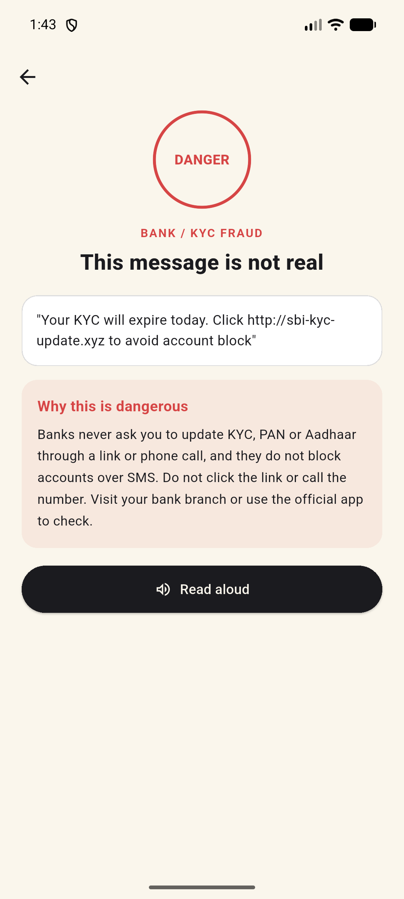
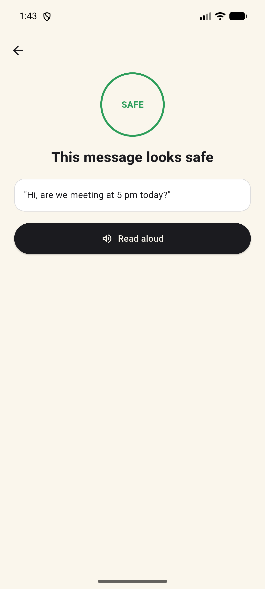

# Scam Guard

A mobile app that checks suspicious messages and links for scams. Built by Team Data Guardians for the Smart India Hackathon 2026 internal round (selected as 1 of 5 teams out of 14).

## What it does
- Scans text shared from other apps and incoming SMS/notifications
- Sends it to the FastAPI backend (`POST /scan`) and shows a verdict with an explanation
- Reads warnings aloud (text-to-speech) in English, Hindi and Bengali
- Weekly digest for family members (`GET /digest/{userId}`)

## Structure
- `scam_guard_app/` - Flutter app (Android)
- `backend/` - FastAPI backend (see `backend/README.md`)

## Run the app
    cd scam_guard_app
    flutter pub get
    flutter run

The API address is set in `lib/services/api_service.dart` (`10.0.2.2:8000` for the Android emulator, your laptop's WiFi IP for a real phone).

## Team
- [Soham Dey](https://github.com/Soham5454) - team lead, Flutter app, architecture
- [Ayus Chakraborty](https://github.com/ayuschakraborty108-ops) - original FastAPI backend design and implementation

## Screenshots

| Home | Scam detected | Safe message |
|---|---|---|
|  |  |  |

